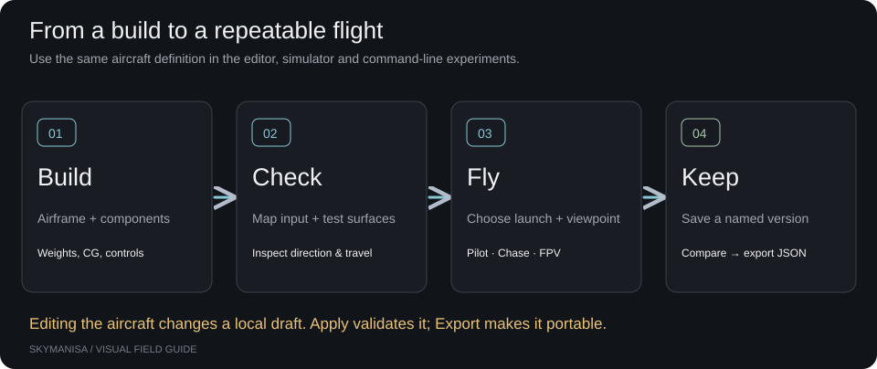

# Fixed-wing RC flight simulator

This simulator flies **fixed-wing RC aircraft** over the Manisa field in your
browser, with your own RC transmitter. Customize components, balance and
controls; your setups stay in your browser until you export them. It runs
locally or on your own host without accounts, API keys or AI services.

## New here? Start with a flight

Follow [Your first flight](getting-started.md) to run the simulator, choose an
aircraft and connect your transmitter. On the first visit a **setup wizard**
detects the transmitter, its stick mode, centres, endpoints and channels.

After that, learn [views and flight setup](flight-guide.md) or
[controls and calibration](controllers.md).

## What would you like to do?

| Your task                                                | Open this guide                                          |
| -------------------------------------------------------- | -------------------------------------------------------- |
| Calibrate your transmitter again                         | [Controls and calibration](controllers.md)               |
| Connect a FlySky transmitter                             | [Choose a radio connection](radio-setup.md)              |
| Move the pilot, position the aircraft or change the view | [Views and flight setup](flight-guide.md)                |
| Change a battery, move the CG or save a setup            | [Edit, balance and save an aircraft](aircraft-editor.md) |
| Add an FPV camera or change rates and mixing             | [Cameras, rates and mixing](fpv-and-control-setup.md)    |
| Solve a connection or flight problem                     | [Troubleshooting](troubleshooting.md)                    |

## Build on an existing aircraft

Change one thing at a time and save a version before experimenting. Start in the
[aircraft editor](aircraft-editor.md); use the
[aircraft file format](aircraft-authoring.md) when you want to add a definition
in code. The [aircraft plans and credits](plans.md) page names the original
designers. Model-specific notes cover the
[Flite Test designs](flite-test-reconstruction.md) and the
[Vortex Simple Trainer](vortex-simple-trainer.md).

## How realistic is it?

The bundled aircraft use estimated physics. Passing a software test does not
establish that a real aircraft will fly the same way. Start with
[benchmarks and evidence](benchmarks.md) for the actual results, then read the
[known limits](validation.md).

## About these docs

Use the sidebar to browse a topic, or **Search docs** to find a term. Each page
identifies its documentation version. **Development** describes the current work.
