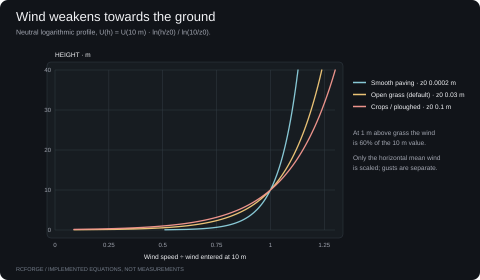
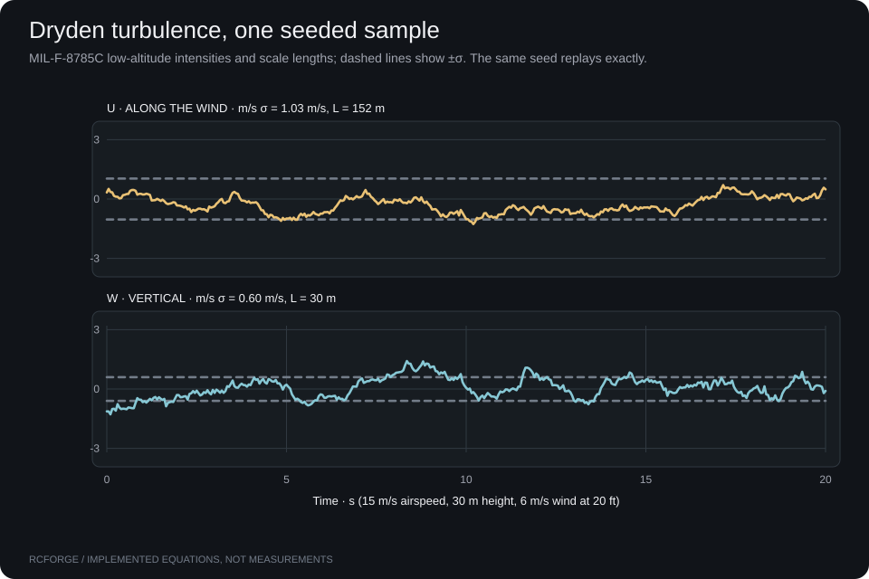
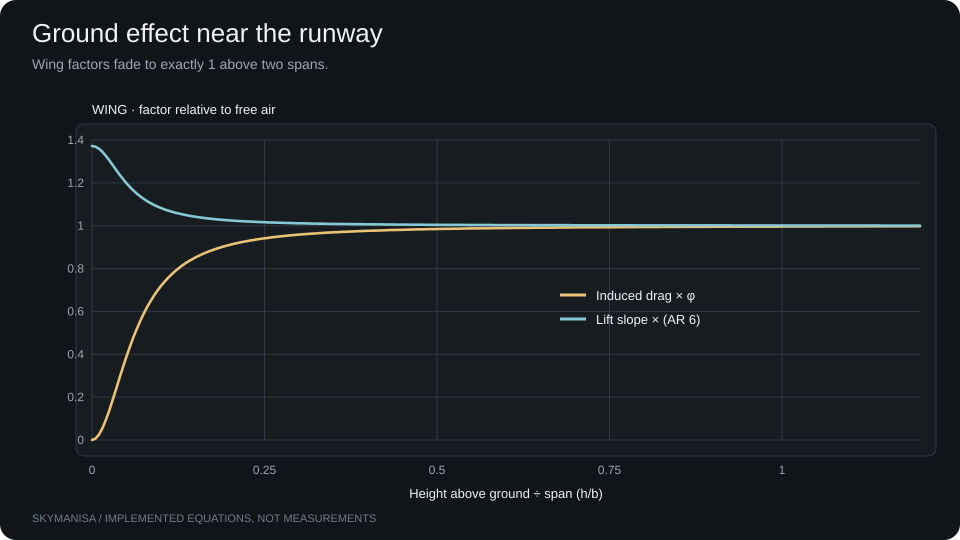

# Turbulence, wind gradient and ground effect

Simulation 0.9.0 adds Dryden turbulence, a wind gradient and wing and rotor ground effect. Two are weather options
you choose in **Flight setup → Field**; two act on every aircraft close to the
ground. They use published engineering relations, not measurements of a
particular field or airframe.

## Use them in a flight

1. Open **Flight setup → Field** and set **Wind** above zero.
2. Tick **Dryden turbulence (scales with wind)** for random, repeatable gusts.
   With zero wind there is no turbulence, as in the specification.
3. Tick **Wind gradient near ground (wind set at 10 m)** so the wind you entered
   applies at 10 m and weakens towards the ground.
4. Start the flight. Recordings keep both options and the seed, so an exported
   flight replays exactly.

Ground effect needs no setting. Expect a longer float in a flare.

## Wind gradient



The neutral-stability logarithmic profile scales only the horizontal mean wind:

```text
U(h) = U(h_ref) · ln(h / z0) / ln(h_ref / z0),   U = 0 for h ≤ z0
```

The browser uses `h_ref = 10 m` and roughness length `z0 = 0.03 m`, the WMO
(Davenport) class for open flat terrain with grass. At 1 m the wind is 60% of the
10 m value; at 30 m it is about 19% stronger. A recording may store a different
`environment.windProfile` (`referenceHeightM` 1–100 m, `roughnessLengthM`
below it). Height is the CG height above the flat collision plane.

## Dryden turbulence (MIL-F-8785C, low altitude)



Below 1000 ft the specification ties intensity and scale length to height `h`
in feet and the mean wind `W20` at 20 ft (6.1 m):

```text
σw = 0.1·W20            σu = σv = σw / (0.177 + 0.000823 h)^0.4
Lw = h                  Lu = Lv = h / (0.177 + 0.000823 h)^1.2
```

Height is clamped to 10–1000 ft. With a wind gradient, `W20` comes from the
profile; otherwise it is the horizontal wind magnitude. Each axis uses the
discrete first-order Dryden recursion with an exact exponential coefficient:

```text
x[k+1] = a·x[k] + σ·√(1 − a²)·η[k],   a = exp(−V·Δt / L)
```

`η` is unit Gaussian noise from a seeded generator, and `V` is the airspeed
(minimum 1 m/s). The stationary variance is exactly `σ²`, and the process stays
stable at any timestep. The gust axes follow the mean wind: `u` along it, `v` to
its right and `w` down. The first state is drawn from the stationary
distribution. The generator advances once per 120 Hz step and is held over the
two midpoint stages.

The existing **Variable gusts** option is still a deterministic sinusoid. It can
be combined with turbulence.

## Wing in ground effect



For each roughly horizontal surface (vertical tails and panels rolled more than
45° are excluded), with span `b` and quarter-chord height `h`:

```text
φ = (16h/b)² / (1 + (16h/b)²)              McCormick induced-drag factor
a_ge = a0 / (1 + φ·a0/(πAe)),  a0 = a / (1 − a/(πAe))
```

`a` is the surface's finite-wing `liftSlope`. Lift is multiplied by `a_ge / a`,
and the induced part of drag becomes `φ·CL²/(πAe)`. Both changes fade out
through the stall blend. With polar tables, the same estimated induced
component is replaced. Between one and two spans the small remainder
(`1 − φ < 0.4%`) blends smoothly to exactly 1. Free-air trim, envelope and
reference cases are therefore unchanged.

At `h/b = 0.1` an AR 6 wing has `φ ≈ 0.72`, about 28% less induced drag and
about 8% more lift slope. The effect grows quickly in the last few centimetres
of a flare.

## What this does not model

- Measured site turbulence, thermals, terrain-induced or obstacle wake wind, and
  stability classes other than neutral.
- Gust gradients across the span (Dryden `p`, `q`, `r` terms). Every surface sees
  the same gust, so turbulence does not roll the aircraft by itself.
- Downwash lag. Since simulation 0.9.2 the tail sees the wing's downwash
  `2·C_L/(π·AR)`, reduced by the wing's ground-effect factor, so a flare loses
  some tail download as in a real aircraft. The time lag of that downwash
  (the α̇ term) is not modeled.
- Partial ground effect over slopes, mountain terrain or obstacles; the solver's
  ground is still a flat plane at zero height.

Tests in `tests/atmosphere.test.ts` check the published formulas, the turbulence
variance and correlation length, the ground-effect direction, and exact replay.
They establish that the implementation follows these equations. They do not
calibrate any aircraft against flight data.

## Sources

- U.S. Department of Defense, MIL-F-8785C, _Flying Qualities of Piloted
  Airplanes_ (1980), Dryden low-altitude model; discrete forms as documented in
  MathWorks Aerospace Blockset, "Dryden Wind Turbulence Model (Discrete)".
- B. W. McCormick, _Aerodynamics, Aeronautics, and Flight Mechanics_, Wiley:
  ground-effect induced-drag factor.
- I. C. Cheeseman and W. E. Bennett, "The Effect of the Ground on a Helicopter
  Rotor in Forward Flight", ARC R&M 3021 (1955).
- WMO, _Guide to Meteorological Instruments and Methods of Observation_,
  Davenport roughness classification.
