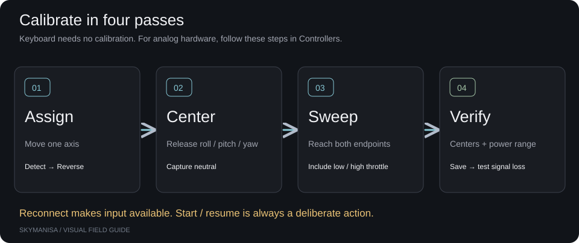
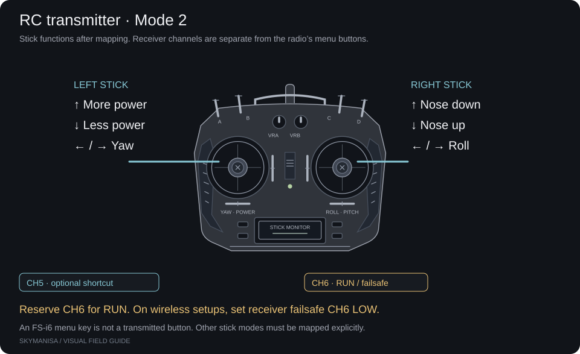

# Set up your transmitter

The simulator is flown with an **RC transmitter** connected by USB (the radio's
own USB joystick mode, a USB simulator dongle, or the Arduino bridge described in
[choose a radio connection](radio-setup.md)). Keyboard, gamepad and flight-stick
flying were removed.

If a device is missing or input stops, use [troubleshooting](troubleshooting.md).

## Setup wizard

On the first visit, or whenever no calibration is saved, a full-screen wizard
opens. Run it again at any time from **Controllers → Run setup wizard** or
**Fly → Flight setup → Input → Run transmitter setup wizard**.

```text
1 Connect ──► 2 Stick mode ──► 3 Centre ──► 4 Endpoints ──► 5 Channels
   (move a      (Mode 1–4)      (rest,         (sweep every     (throttle up/down,
    stick)                       1.5 s)          corner)          aileron, elevator,
                                                                  rudder left/right)
                                                                        │
8 Save ◄── 7 Test (live bars, expo preview, ◄── 6 Switches (optional:
              throttle must be at idle)            arm, flight mode)
```

1. **Connect.** Plug in the transmitter, switch on its USB joystick or
   simulator mode, then move a stick or press a button: browsers only reveal a
   controller after interaction. The wizard shows the device name, or waits
   with connection hints. With several devices, choose one.
2. **Stick mode.** Mode 1–4 says which stick carries throttle and elevator
   (Mode 2: throttle and rudder left, elevator and aileron right). The mode is
   used for the instructions and the test view; the axes themselves are
   detected in step 5.
3. **Centre.** Let the self-centring sticks rest. The wizard averages each
   axis for 1.5 s, records its centre and its peak-to-peak noise, and
   suggests a deadzone of three times that noise (2–15 % of half travel).
4. **Endpoints.** Move both sticks around the full circle. Each axis records
   its minimum and maximum; continue when four axes have reached their ends.
5. **Channels.** Follow eight prompts: throttle up then down, aileron left then
   right, elevator up then down, rudder left then right. Each prompt waits for
   the sticks to settle, then takes the axis that moves most (by at least a
   quarter of its travel) and held for a quarter of a second. The direction
   sets the reversal automatically: throttle up reads 100 %; aileron right,
   elevator pulled back (nose up) and rudder right read positive. Moving an
   axis already assigned to another channel, a different axis than in the
   first move, or the same direction twice shows a warning instead.
6. **Switches (optional).** Assign an **arm** switch (when disarmed the motor
   stays at zero and the OSD shows DISARMED) and a **flight-mode** switch
   (ACRO / MANUAL). Skip if your radio has none.
7. **Test.** Live bars show every channel before and after your expo setting,
   with both sticks drawn for your mode. Continue only with the throttle fully
   down.
8. **Save.** The summary lists the mapping. **Save and start flying** stores it
   and returns to the field.

**Skip setup** keeps the default mapping; a warning then appears when a flight
starts. When a different transmitter is connected later, the app offers to
calibrate it.

### Calibration object and normalization

The result is one versioned object (controller profile version 2), stored in
browser storage under the device ID: for each channel the axis, `min`,
`center`, `max`, `reversed`, `deadzone` and `expo`; the stick mode; optional
switches; and the measured rest noise. Version-1 profiles still load.

Stick channels are normalized piecewise about the centre, so a rest point that
is not midway between the endpoints still reads 0:
`x = (raw − center)/(max − center)` above the centre and
`(raw − center)/(center − min)` below, clamped to ±1, then reversed if needed,
then deadzone, then expo. Throttle uses the full span,
`t = (raw − min)/(max − min)`.

### Throttle safety

A flight does not start while the throttle reads above 5 %; lower the stick
fully first, as an ESC would require before arming.

### Manual mapping

**Controllers** still offers manual mapping, per-axis **Detect**, reverse,
centre/range capture and response settings for fine adjustments after the
wizard.



Saved bindings for actions that no longer exist (such as the former VTOL
switches) are ignored without an error. Losing window focus pauses flight.

## FlySky FS-i6



Start with the [visual radio connection guide](radio-setup.md), including a copyable prompt for help with your exact hardware.

See the [FS-i6 wiring and Arduino guide](flysky-fs-i6.md) for the original transmitter's trainer output, receiver PPM, or six receiver PWM channels. It includes the Uno/Nano sketch, upload steps, receiver failsafe setup and troubleshooting.

A compatible PPM-to-USB **joystick** adapter uses **Find devices**. A classic Nano/Uno running the bridge uses **Connect Arduino** in the RC transmitter tab, with a Web Serial-capable browser. A programming cable alone does not provide simulator input. Serial disconnects do not silently switch to another controller or resume flight.

## Physical acceptance checklist

Trainer-to-Nano reception has user-supplied diagnostic evidence, but receiver connections and complete flight acceptance remain unverified. Record your device, adapter, firmware, OS and browser as you check:

- [ ] Device appears and remains connected.
- [ ] Four independent channels are exposed with smooth motion.
- [ ] Axis assignments and reversal match stick intent.
- [ ] Pitch/roll/yaw centers return to zero; throttle reaches 0–100%.
- [ ] Saved calibration reloads correctly.
- [ ] No unwanted double expo or transmitter/software trim interaction.
- [ ] Disconnect pauses flight; reconnect requires deliberate resume.
- [ ] Device swap does not silently reuse incompatible calibration.
- [ ] A complete launch, turn, glide and reset is usable at normal frame rate.

The Arduino bridge shares the same mapping and calibration path as HID controllers. It accepts the documented simulator serial protocol only; arbitrary USB serial or iBUS devices cannot be plugged in as if they were joystick adapters.

## Save or transfer a setup

Export/import under **Aircraft trim & profile files** transfers a profile JSON. An import is attached to the selected device and requires its available axes. Verify directions before saving. Unsaved changes are marked beside the device selector.

## Controller shortcuts

Choose the **Shortcuts** tab to assign Start/pause, Restart, Pilot/chase/FPV, Cycle control response, or Settings to a button or an unused axis endpoint. Standard gamepads use PlayStation/Xbox button names; custom adapters retain one-based hardware numbers. The live diagram and pressed-button indicator help identify inputs. Analog flight axes are reserved and cannot trigger shortcuts. Move a switch back before triggering its next action. Holding a button does not repeatedly restart, and connecting with a switch already on does not trigger an action.

For settings navigation assign Next setting, Previous setting, Activate, Decrease and Increase. Focus is outlined; decrease/increase adjusts selected numeric fields or dropdowns. Next/previous can reach all three flight setup tabs; Activate opens the focused tab. Navigation stays inside an open aircraft catalog or guide; focus wraps between its visible controls, and flight commands wait until the dialog is closed. Decrease/increase skips unavailable dropdown options. Shortcuts are stored separately per device in this browser. They do not change transmitter firmware or hardware menus. Leave controls unassigned if the USB adapter does not expose enough inputs. A four-axis simulator adapter may expose no spare switches or buttons.

## Flight reference display

See [the flight reference panel](flight-guide.md#read-the-flight-reference-panel) for the attitude indicator, minimap and pilot/aircraft markers.

## Response and movement tests

Use [FPV and control setup](fpv-and-control-setup.md) for adjustable response curves, per-aircraft defaults, live servo motion and surface mixers. New standard gamepad shortcuts assign L1/LB to response cycling; existing saved bindings are retained.
